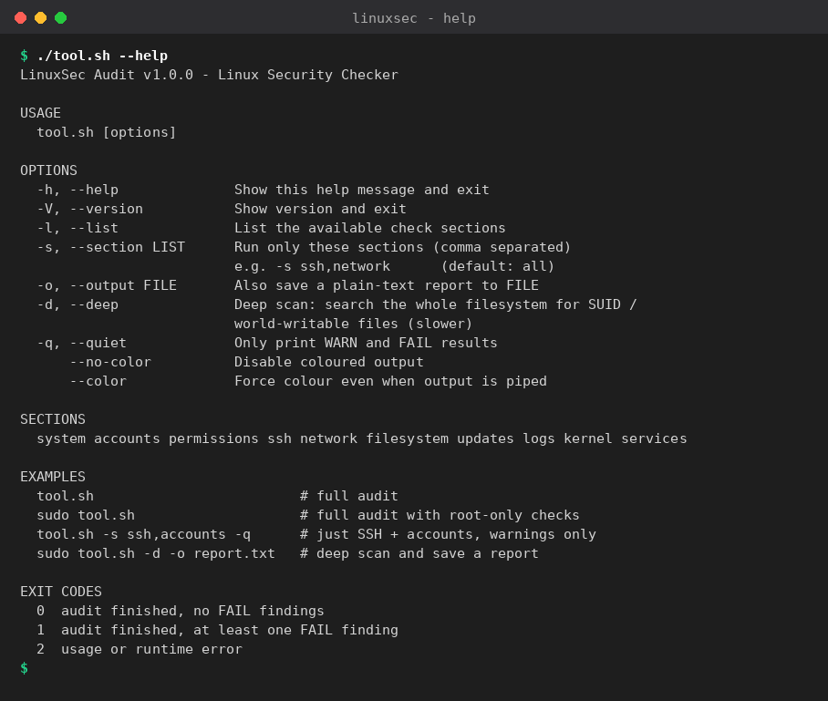
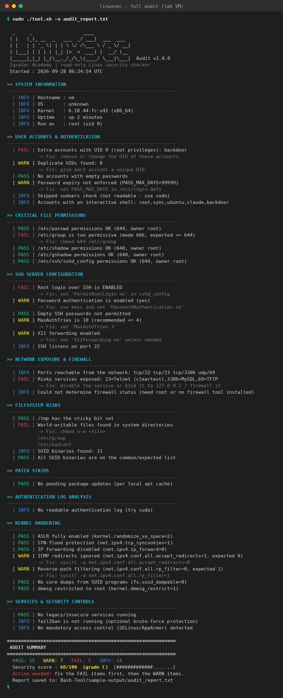
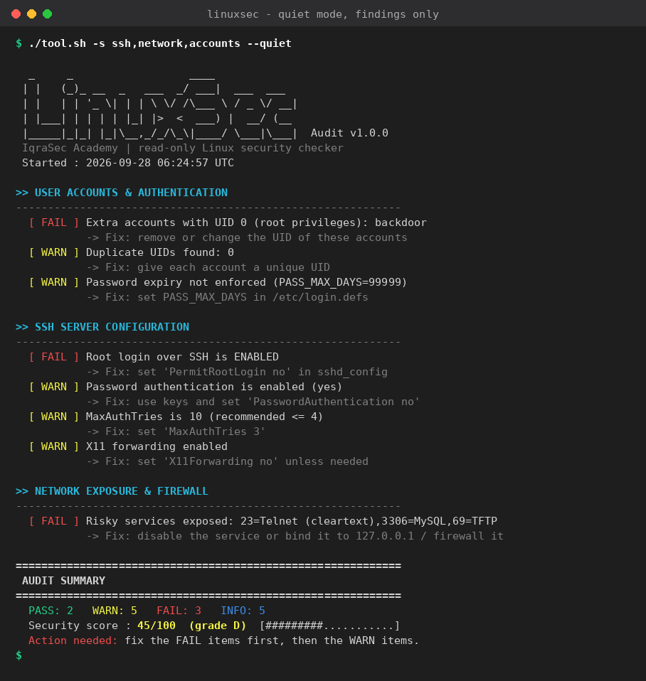
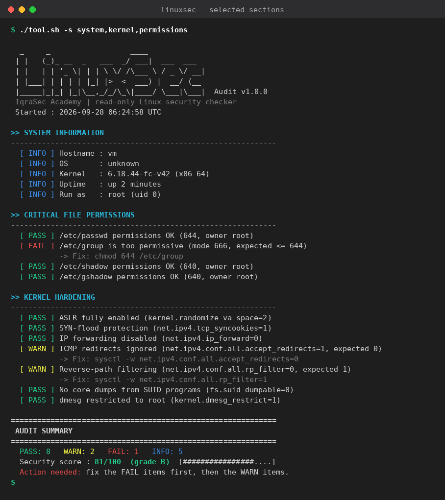

# LinuxSec Audit — Linux Security Checker (Bash)

> IqraSec Academy · Cybersecurity Scripting & Automation Internship · Phase 1 · **Task 1 (Bash)**

## Objective
Automate the first hour of a Linux hardening review. `tool.sh` inspects a host against widely used
hardening practices (in the spirit of the CIS Benchmarks), prints a colour-coded **PASS / WARN / FAIL**
report with a one-line **fix** for every problem, and finishes with a **0–100 security score and grade**.
The tool is **read-only** — it never modifies the system it audits.

## Features
| Area | What is checked |
|---|---|
| **System** | Hostname, OS, kernel, uptime, current user |
| **Accounts** | Extra UID 0 accounts, duplicate UIDs, empty passwords, password-ageing policy, passwordless `sudo` |
| **Permissions** | Mode + owner of `/etc/passwd`, `group`, `shadow`, `gshadow`, `sudoers`, `sshd_config`, `crontab` |
| **SSH** | `PermitRootLogin`, `PasswordAuthentication`, `PermitEmptyPasswords`, `MaxAuthTries`, `X11Forwarding` (uses `sshd -T` when root) |
| **Network** | Listening ports exposed beyond localhost, risky services (Telnet, FTP, TFTP, MySQL, Redis, VNC, RDP, …), firewall status (ufw / firewalld / nftables / iptables) |
| **Filesystem** | `/tmp` sticky bit, world-writable files in system dirs, uncommon SUID binaries, orphaned files (`--deep`) |
| **Updates** | Pending package updates (apt / dnf), security-update detection, reboot-required flag |
| **Logs** | Failed SSH logins, invalid-user attempts, top 5 attacking IPs (brute-force detection) |
| **Kernel** | ASLR, SYN cookies, IP forwarding, ICMP redirects, rp_filter, SUID core dumps, dmesg restriction |
| **Services** | Legacy/insecure services running, fail2ban, SELinux / AppArmor |

Extras: `--section` selection · `--quiet` findings-only mode · `--output` plain-text report ·
`--deep` full-filesystem scan · `--no-color` · meaningful **exit codes** (0 clean, 1 findings, 2 error) so it can be
used in scripts and CI.

## Requirements
* Linux (Debian/Ubuntu/Kali, RHEL/Fedora, Arch…) with **Bash 4+**
* Standard tools: `awk`, `sed`, `grep`, `find`, `stat`, `ss` *or* `netstat`
* `sudo`/root is **recommended** (a few checks such as `/etc/shadow`, firewall rules and auth logs need it). Without root the tool still runs and clearly reports which checks were skipped.

## How to Run
```bash
git clone <your-repo-url> && cd Phase-1/Bash-Tool
chmod +x tool.sh

./tool.sh --help            # usage
./tool.sh                   # full audit (limited without root)
sudo ./tool.sh              # full audit, all checks
```

### Options
```
-h, --help          Show help          -V, --version   Show version
-l, --list          List sections      -s, --section   Run only these sections (comma separated)
-o, --output FILE   Save plain report  -d, --deep       Deep filesystem scan (slower)
-q, --quiet         WARN/FAIL only     --no-color      Disable colours       --color  Force colours
```
Sections: `system accounts permissions ssh network filesystem updates logs kernel services`

## Example Usage
```bash
sudo ./tool.sh                          # everything
./tool.sh -s ssh,network,accounts -q    # only these sections, only problems
sudo ./tool.sh -d -o audit_report.txt   # deep scan + save a report
./tool.sh -s system,kernel --no-color   # plain output for logs
sudo ./tool.sh -q; echo "exit=$?"       # use the exit code in automation
```

## Example Output
Run against a deliberately weakened **lab VM** (backdoor UID-0 account, `PermitRootLogin yes`, Telnet exposed):
```
>> USER ACCOUNTS & AUTHENTICATION
------------------------------------------------------------
  [ FAIL ] Extra accounts with UID 0 (root privileges): backdoor
           -> Fix: remove or change the UID of these accounts

>> SSH SERVER CONFIGURATION
------------------------------------------------------------
  [ FAIL ] Root login over SSH is ENABLED
           -> Fix: set 'PermitRootLogin no' in sshd_config
  [ WARN ] Password authentication is enabled (yes)
           -> Fix: use keys and set 'PasswordAuthentication no'

>> NETWORK EXPOSURE & FIREWALL
------------------------------------------------------------
  [ FAIL ] Risky services exposed: 23=Telnet (cleartext),3306=MySQL,69=TFTP
           -> Fix: disable the service or bind it to 127.0.0.1 / firewall it

============================================================
 AUDIT SUMMARY
============================================================
  PASS: 2   WARN: 5   FAIL: 3   INFO: 5
  Security score : 45/100  (grade D)  [#########...........]
  Action needed: fix the FAIL items first, then the WARN items.
```
A full plain-text report is in [`sample-output/audit_report.txt`](sample-output/audit_report.txt).

| | |
|---|---|
|  |  |
|  |  |

## How It Works
1. `parse_args` validates options and the report path *before* any work starts.
2. Each check lives in its own `check_<section>` function and reports through one `result` helper, so output, counters and the report file stay consistent.
3. Scoring: `PASS = 1 point`, `WARN = 0.5`, `FAIL = 0`, `INFO` is not scored → score = points / checks × 100.
4. Grade bands: A ≥ 90, B ≥ 75, C ≥ 60, D ≥ 40, F below.

## Challenges Faced
* **Portable parsing** – `ss` and `netstat` print different columns, and `sshd_config` can be split across `sshd_config.d/*.conf`; I normalised both and used `sshd -T` (effective config) when root.
* **False positives** – early versions flagged every SUID binary. I added a list of expected SUID programs so only *unusual* ones are reported.
* **Not breaking when unprivileged** – many files (`/etc/shadow`, sudoers, auth logs) are root-only. Each check detects this and reports “skipped” instead of crashing or giving a false PASS.
* **Slow scans** – `find /` can take minutes, so the default scans only system directories, and every `find` is wrapped in `timeout`.
* **Bash gotchas** – `set -u` with empty arrays, `grep -c` returning exit-code 1 on zero matches, and counting with `((x++))` were all tracked down through testing in a weakened lab VM.

## Future Improvements
* JSON / HTML report output and a `--compare` mode to diff two audits over time
* More CIS controls (PAM lockout, auditd rules, mount options, cron/at permissions)
* Optional `--fix` mode that applies safe remediations after confirmation
* Container/Docker and cloud-image checks
* Unit tests with [`bats`](https://github.com/bats-core/bats-core)

## Legal & Ethical Use
Audit only systems you own or are **authorised** to assess. The tool is read-only, but scanning
other people's machines without permission may be illegal.
