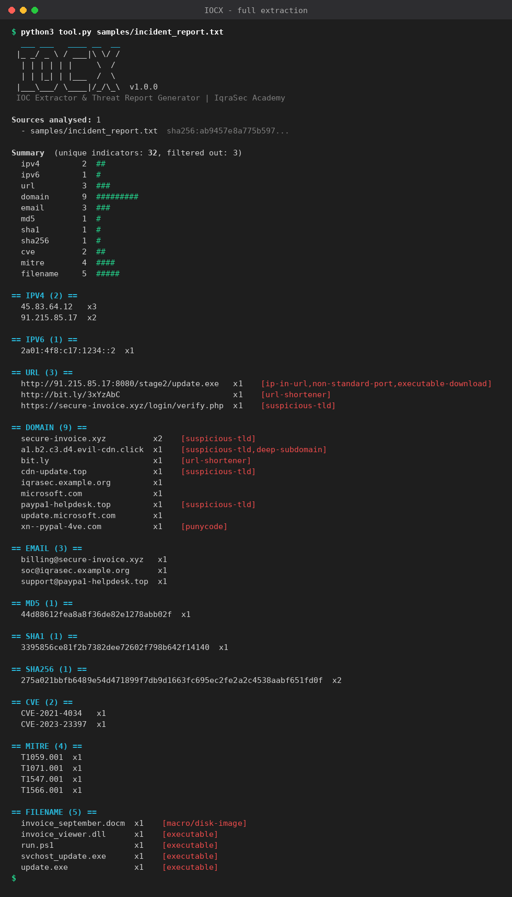
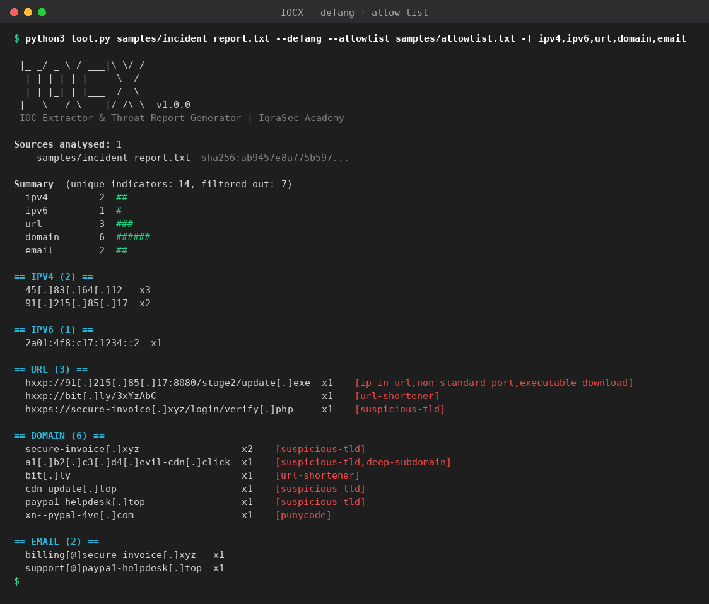
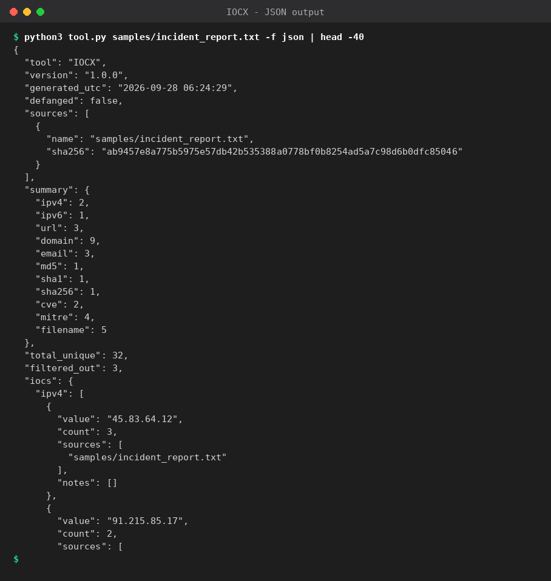
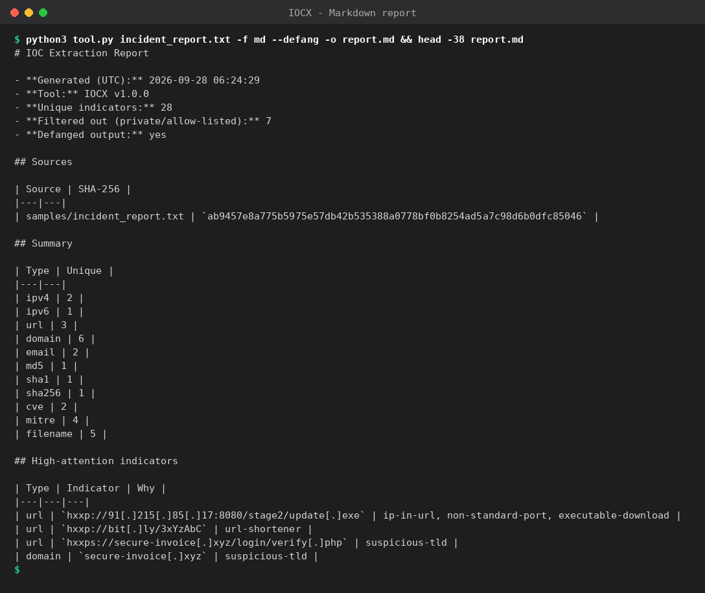
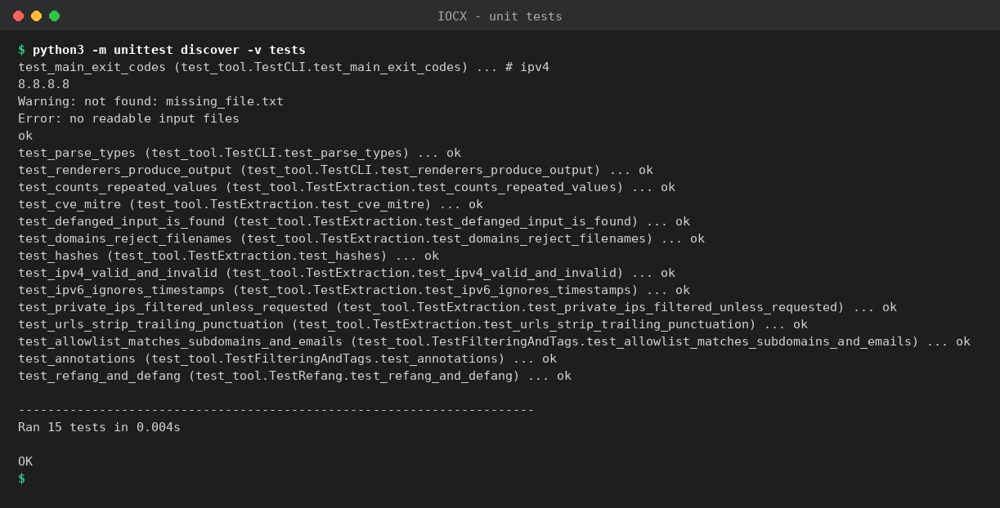
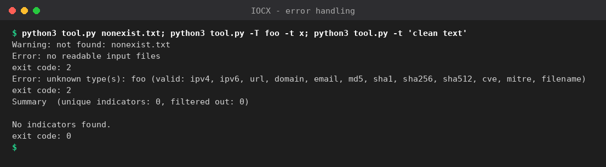

# IOCX — IOC Extractor & Threat Report Generator (Python)

> IqraSec Academy · Cybersecurity Scripting & Automation Internship · Phase 1 · **Task 2 (Python)**

## Objective
SOC analysts and incident responders spend a lot of time copying indicators out of reports, phishing
e-mails and logs by hand. **IOCX** automates that: point it at any text and it extracts, cleans,
de-duplicates, risk-tags and reports every **Indicator of Compromise** — ready to paste into a SIEM,
firewall block-list or incident ticket.

## Features
* **12 indicator types:** IPv4, IPv6, URLs, domains, e-mails, MD5, SHA-1, SHA-256, SHA-512, CVE IDs, MITRE ATT&CK technique IDs, suspicious file names (`.exe .dll .ps1 .docm` …)
* **Defang-aware:** understands `hxxps://evil[.]com`, `user[@]bad[.]org`, `(.)`, `[dot]` and re-fangs them before matching; `--defang` makes output safe to share
* **Low false positives:** validates IP octets, checks IPv6 with `ipaddress`, requires a real TLD (so `setup.py`, `run.sh` and timestamps are *not* reported), ignores all-digit “hashes”
* **Noise filtering:** drops private / loopback / reserved IPs (`--include-private` to keep) and supports an **allow-list** that also matches sub-domains and e-mail domains
* **Risk tagging:** `suspicious-tld`, `url-shortener`, `punycode`, `ip-in-url`, `non-standard-port`, `executable-download`, `deep-subdomain`, …
* **Evidence tracking:** SHA-256 of every input file is recorded in the report
* **Flexible input:** files, whole folders (`-r`), `stdin` pipes, or `-t "text"`; handles UTF-16 Windows logs
* **6 output formats:** coloured table · JSON · CSV · TXT · **Markdown report** · **HTML report**
* Clean structure: small single-purpose functions, type hints, **15 unit tests**, standard library only, correct exit codes

## Requirements
* Python **3.8+**
* **No third-party packages** (standard library only)

## How to Run
```bash
cd Phase-1/Python-Tool
python3 tool.py --help
python3 tool.py samples/incident_report.txt
```
Run the tests:
```bash
python3 -m unittest discover -v tests
```

### Options
```
inputs                 files/directories to analyse (omit to read stdin)
-t, --text TEXT        analyse a string directly
-T, --types LIST       ipv4,ipv6,url,domain,email,md5,sha1,sha256,sha512,cve,mitre,filename  (default: all)
-f, --format FMT       table | json | csv | txt | md | html      (default: table)
-o, --output FILE      write to a file            -r, --recursive   scan folders
--defang               defang output              --include-private keep private IPs
--allowlist FILE       ignore benign indicators   --min-count N     only indicators seen >= N times
--max-size MB          skip huge files            --no-color / --color
```
Exit codes: `0` IOCs found · `1` none found · `2` error.

## Example Usage
```bash
python3 tool.py samples/incident_report.txt                              # readable table
python3 tool.py logs/ -r -f json -o iocs.json                            # scan a folder → JSON
python3 tool.py -t "beacon to hxxp://evil[.]xyz/a.exe from 45.83.64.12"  # inline text
cat phishing.eml | python3 tool.py --defang -f txt                       # pipe in, safe-to-share list
python3 tool.py samples/incident_report.txt -f md --defang \
        --allowlist samples/allowlist.txt -o report.md                   # Markdown threat report
python3 tool.py samples/incident_report.txt -T ipv4,domain -f txt | sort -u > blocklist.txt
```

## Example Output
```
Sources analysed: 1
  - samples/incident_report.txt  sha256:ab9457e8a775b597...

Summary  (unique indicators: 14, filtered out: 7)
  ipv4         2  ##
  url          3  ###
  domain       6  ######

== URL (3) ==
  hxxp://91[.]215[.]85[.]17:8080/stage2/update[.]exe  x1  [ip-in-url,non-standard-port,executable-download]
  hxxp://bit[.]ly/3xYzAbC                             x1  [url-shortener]
  hxxps://secure-invoice[.]xyz/login/verify[.]php     x1  [suspicious-tld]

== DOMAIN (6) ==
  secure-invoice[.]xyz                  x2  [suspicious-tld]
  a1[.]b2[.]c3[.]d4[.]evil-cdn[.]click  x1  [suspicious-tld,deep-subdomain]
  xn--pypal-4ve[.]com                   x1  [punycode]
```
Ready-made outputs: [`samples/output/`](samples/output) → `report.md`, `report.html`, `iocs.json`, `iocs.csv`.

| | |
|---|---|
|  |  |
|  |  |
|  |  |

## Project Layout
```
Python-Tool/
├── tool.py                    # the tool (extractors, filters, renderers, CLI)
├── samples/incident_report.txt  # realistic defanged incident report to try
├── samples/allowlist.txt        # example allow-list
├── samples/output/              # generated md / html / json / csv reports
├── tests/test_tool.py           # 15 unit tests
└── screenshots/
```

## Challenges Faced
* **Defanged data** – real reports write `hxxp://evil[.]com`; a naïve regex misses everything. A re-fang step runs *before* extraction.
* **False positives** – `setup.py`, `run.sh`, `12:30:45` and `1.2.3.4.5` all look like indicators. I validate each match: real TLD list (ambiguous file-extension TLDs excluded), `ipaddress` for IPv6, strict octet ranges, and negative look-arounds for versions.
* **RFC 5737 documentation IPs** (`203.0.113.x`, `2001:db8::`) are classed as non-routable by Python’s `ipaddress`; I first thought my regex was broken until I traced it — good lesson in debugging filters vs. extractors.
* **Trailing punctuation** in URLs (`http://a.com/x,`) had to be trimmed without damaging valid characters.
* **Allow-listing** must match sub-domains (`cdn.good.com`) but *not* look-alikes (`evilgood.com`), and judge e-mails by their domain — covered by unit tests.

## Future Improvements
* Threat-intel enrichment (VirusTotal / AbuseIPDB / URLhaus APIs, with rate limiting and caching)
* PDF, DOCX and e-mail (`.eml`/`.msg`) parsing; STIX 2.1 and MISP export
* Full public-suffix list for exact TLD validation; Bitcoin/Monero wallets, registry keys, Windows paths
* Package as a `pip install`-able CLI and add GitHub Actions CI

## Legal & Ethical Use
Analyse only data you are authorised to handle. IOCX performs **no network requests** — everything runs locally.
